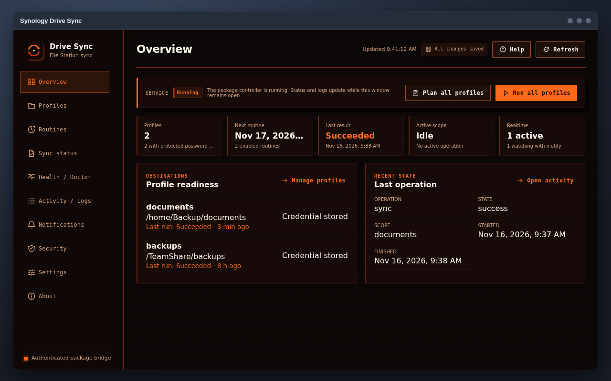

# What a run looks like

## What a run looks like

## Native CLI

Target Doctor prints the build that produced the report, an overall verdict, then one line per
section carrying the step at which that section actually ran, its elapsed time, and its evidence.
Every DSM request a section made is listed beneath it; the sample below keeps the transport and
session requests and drops the rest to stay readable. The host, account, and paths are fictional,
and the report never prints a password, one-time code, session identifier, or SynoToken, because no
field in it is capable of holding one.

```text
$ synology-drive-sync doctor --url https://nas.example.com --username mirror-bot \
    --level standard target /home/Backup/project
synology-drive-sync 26.38 (ae75b0f) x86_64-unknown-linux-gnu
Doctor standard: PASS
  [PASS] step 1/16 Network reachability and connect timing (37 ms): TCP reachability is consistent: connect min 1.8 ms / median 2.0 ms / max 2.4 ms over 3 samples
  [PASS] step 2/16 Routing and TLS negotiation (181 ms shared with routing and discovery): HTTPS route and TLS negotiation succeeded with certificate verification enabled
  [PASS] step 3/16 DSM API discovery (181 ms shared with routing and discovery): DSM Auth and baseline File Station API versions were validated from the discovery response
           #1 SYNO.API.Info.query v1 session=none -> ok http 200 in 181 ms
  [PASS] step 4/16 DSM capability enumeration (96 ms): DSM advertises 214 APIs; all 11 APIs this tool uses are present with compatible versions
  [PASS] step 15/16 Intermediaries and reverse proxies (no request of its own; summarised from the requests other sections made): no proxy, relay, or cache announced itself on any response
  [PASS] step 6/16 DSM session authentication (407 ms): DSM credentials were accepted and an authenticated File Station session was established
           #3 SYNO.API.Auth.login v6 session=none -> ok http 200 in 402 ms
  [PASS] step 7/16 DSM session channel ablation (311 ms): the session is accepted both as this client normally presents it and through the documented _sid request field alone; the synthesised cookie alone was also accepted. Channel selection is not the fault here
           #4 SYNO.FileStation.List.list_share v2 session=cookie+token-header+sid-field+token-field -> ok http 200 in 88 ms
           #5 SYNO.FileStation.List.list_share v2 session=sid-field -> ok http 200 in 74 ms
           #6 SYNO.FileStation.List.list_share v2 session=cookie -> ok http 200 in 71 ms
           #7 SYNO.FileStation.List.list_share v2 session=token-header -> dsm-error http 200 dsm 119 in 69 ms
  [SKIP] step 8/16 Concurrent session fan-out (0 ms): the concurrent fan-out probe runs at the extensive level only
  [PASS] step 16/16 Session cookie permanence (no request of its own; summarised from the requests other sections made): 1 cookie name(s) were set and none was re-issued under a changed value on a successful call
  [PASS] step 5/16 File Station capabilities (no request; answered from the discovery response): the APIs required by the selected quick or standard diagnostic are available
  [PASS] step 9/16 File Station capability diagnosis (298 ms): all 4 probed capabilities work for this account
  [PASS] step 10/16 Destination path resolution (no request of its own; summarised from the requests other sections made): all 3 components of the destination exist and are directories
  [PASS] step 11/16 Destination permissions (146 ms): the authenticated account can create a child in the exact destination
  [PASS] step 12/16 Destination inventory (129 ms): one direct-child page was inspected without recursion; 24 total entries, 5 sampled, 19 truncated
  [SKIP] step 13/16 Disposable write, verify, and cleanup (0 ms): not requested; remote mutation requires the separate --write-test opt-in
  [PASS] step 14/16 DSM session logout (58 ms): the authenticated DSM session was closed
... trimmed here: the reachability, intermediary, cookie-ledger, capability, and path-resolution
    evidence blocks, and the bounded remote-inventory sample ...
Doctor: routing, API discovery, authentication, and remote access are healthy (24 direct entries; destination exists; write permission checked at the exact destination /home/Backup/project).
```

A `WARN` or `FAIL` section adds an indented `hint:` line naming the next step. The same report is
available as `--output json` or `--output ndjson` under the `sdsync.doctor.v1` schema.

The source diagnostic and `plan` are terser. Neither contacts the destination for a mutation, and
`plan` is the exact work `sync` would perform:

```text
$ synology-drive-sync doctor source /srv/project
Source is healthy: 218 files, 24 directories, 486.3 MiB across 242 entries; 0 files hashed in 96 ms (/srv/project).

$ synology-drive-sync plan /srv/project /home/Backup/project \
    --url https://nas.example.com --username mirror-bot
Plan: 3 uploads (12.4 MiB), 0 server copies (verified upload fallback up to 0 B), 1 directories, 0 deletions, 215 unchanged files, 6 protected remote entries.
  MKDIR  /home/Backup/project/reports/2026-q3 (missing-remote: no remote entry at this path)
  UPLOAD reports/2026-q3/summary.pdf -> /home/Backup/project/reports/2026-q3/summary.pdf (missing-remote: no remote entry at this path)
  UPLOAD notes/decisions.md -> /home/Backup/project/notes/decisions.md (content-differs: size equal, MD5 content digests differ)
  UPLOAD notes/todo.md -> /home/Backup/project/notes/todo.md (mtime-differs: size equal, modification time differs)
Plan only; no remote changes were made.
```

The same run as `sync` closes with `Sync complete: 3 uploaded (12.4 MiB), 0 copied on NAS, 1
directories created, 0 remote entries deleted in 8420 ms.`

## DSM 7 package dashboard

The DSM package is a native AppWindow rather than a terminal. This is its Overview page, rendered
from the real built bundle against demo data (see
[`scripts/readme-assets`](https://github.com/supermarsx/synology-drive-sync/tree/main/scripts/readme-assets)
for how the image is produced):



What each page is for: **Profiles** edits a source, endpoint, account, destination, comparison
mode, and a separate deletion guard, with NAS and File Station folder browsers and password, TOTP,
and remote-log-token fields that store masked and are never read back. **Routines** attaches
interval, daily, or realtime automation per profile, with debounce, poll fallback, retry backoff,
active weekdays, and its own deletion-approval ceiling. **Health / Doctor** runs the target
diagnostic above at a chosen depth, keeps the section evidence and a per-profile cached view of
reachability, writability, latency, and free space, and can copy the whole report. **Activity /
Logs** is the structured event stream with bounded package logs. **Notifications** sets DSM desktop
alerts and their failure thresholds and cooldown. **Security**, **Settings**, and **About** hold
package policy, interface preferences, and build identity. Valid edits autosave, and the window
stays read-only until the authenticated DSM bridge is available.
