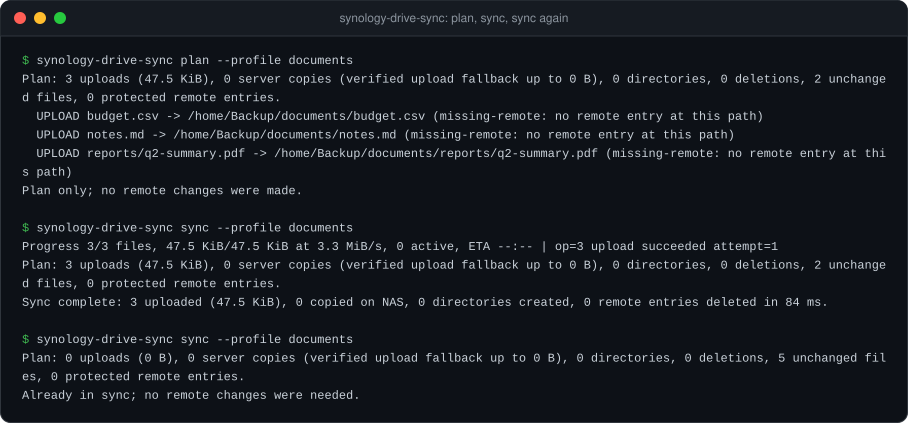
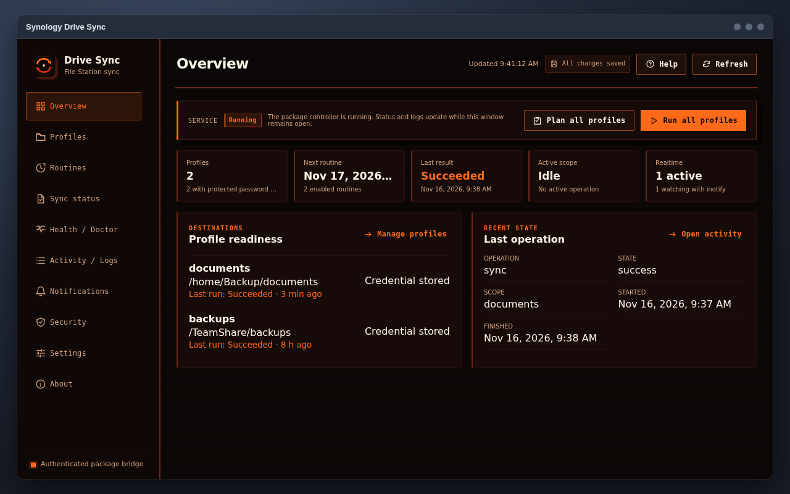

# synology-drive-sync

**Push files from any machine to your Synology NAS, one way, over DSM's File Station API.**

[](https://github.com/supermarsx/synology-drive-sync/actions/workflows/ci.yml)
[](https://github.com/supermarsx/synology-drive-sync/releases/latest)
[](license.md)
[](Cargo.toml)
[](https://supermarsx.github.io/synology-drive-sync/installation.html)

`synology-drive-sync` is a finite, one-way **file deposit**. It scans a folder, uploads what is
missing or changed to a File Station path on your NAS with an ordinary DSM account, verifies the
result, logs out, and exits. The source is opened read-only and is never intentionally changed. Run it by hand, from
a scheduler, from a script or CI job, from your own code, or on the NAS itself.

<p align="center">
  
</p>
<p align="center">
  
</p>

<sub>Both images are generated from the real code by [`scripts/readme-assets`](scripts/readme-assets):
the CLI image is the real binary running against the repository's File Station mock, and the
dashboard is the real built DSM AppWindow rendered with demo data.</sub>

```text
 a machine, CI runner or container                          your Synology NAS
 ┌───────────────────────────────┐   HTTPS, a DSM account   ┌──────────────────────────────┐
 │ source folder (read-only)     │ ───────────────────────▶ │ File Station path, e.g.      │
 │ synology-drive-sync           │   File Station WebAPI    │ /home/Drive/reports          │
 └───────────────────────────────┘                          └──────────────────────────────┘
```

## What it is, and when to use it

**It is a way to get files onto a Synology NAS from machines that cannot run Synology Drive
Client.** Use it when the client is not supported on the machine or you are not permitted to install
it there:

- headless Linux servers, containers, and CI runners;
- operating systems or CPU architectures the client does not cover;
- machines where installing the client is not allowed.

It talks to DSM's File Station API with a normal DSM account, so nothing extra is installed on the
NAS. If the destination is inside the account's My Drive or an enabled Team Folder, Synology Drive
can index what was deposited, so the files reach Drive clients, without this tool speaking Drive's
protocol.

**It is also built to be driven by code.** Send files to a remote NAS from scripts and pipelines with
the CLI (`--output json` or `ndjson` for machine-readable results, and `plan --exit-code`, which
returns `10` when changes are pending), or embed the engine: Rust callers use the synchronous
`synology_drive_sync::sdk::Engine`, and other languages use the versioned JSON-over-C ABI. It also
runs unattended in a hardened container, and as a DSM package on the NAS itself.

**What it is not.** It is a deposit, not a sync client, and it does not replace Drive Client:

- It does not reconcile in two directions. An edit made on the NAS is never brought back, and the
  next local change to that path overwrites it.
- There is no Drive conflict protocol, on-demand or selective sync, block-level delta, or resumable
  upload.
- It carries content, hierarchy, names, and file mtime. ACLs, ownership, modes, and extended
  attributes are not preserved.
- It is not a backup: it keeps no history, so a local file that is corrupted or encrypted in place is
  what the next run uploads over the good remote copy.

> [!WARNING]
> **Young software.** The repository dates from August 2026 and has been exercised against very few NAS
> models and DSM builds. Automated tests use local filesystems and mock HTTP services; they do not log
> in to a live NAS. Read [`security.md`](security.md) before storing credentials, treat the safety notes
> below as literal, and complete the
> [disposable live-NAS acceptance runbook](https://supermarsx.github.io/synology-drive-sync/production-acceptance.html)
> before pointing it at anything you would miss.

## Quick start

Each path is: install in one line, make a first deposit, then make it recurring. Prepare DSM first: a
dedicated non-administrator account with File Station application permission and read/write access to
the destination, reachable over HTTPS at a URL that routes `/webapi/entry.cgi`. The destination is a
File Station path such as `/home/Drive/reports` or `/TeamShare/Project`, never a DSM filesystem path
such as `/volume1/...`. Examples use `https://nas.example.com` and the account `deposit-bot`.

<details open>
<summary><b>Linux and macOS</b></summary>

```sh
curl -fsSL https://raw.githubusercontent.com/supermarsx/synology-drive-sync/main/scripts/install.sh | sh
```

Safer: `curl -fsSLO https://raw.githubusercontent.com/supermarsx/synology-drive-sync/main/scripts/install.sh && less install.sh && sh install.sh`

The installer picks the asset for your OS and CPU, verifies it against the release `SHA256SUMS`, and
installs into `~/.local/bin` without `sudo`. It prints the `PATH` line to add if needed. Pin a release
with `SDSYNC_VERSION=26.66` or a directory with `SDSYNC_INSTALL_DIR`.

First deposit:

```sh
synology-drive-sync credentials set-password --url https://nas.example.com --username deposit-bot
synology-drive-sync plan ./reports /home/Drive/reports --url https://nas.example.com --username deposit-bot
synology-drive-sync sync ./reports /home/Drive/reports --url https://nas.example.com --username deposit-bot
```

The password is prompted for and kept in the macOS Keychain or the Linux Secret Service. On a headless
server without a keyring, keep it in a `0600` file and add `--password-file ~/.config/nas-password
--no-vault` to each command. `plan` shows exactly what `sync` would do and changes nothing.

Recurring (cron; a systemd timer and a launchd agent are documented too):

```sh
*/30 * * * * "$HOME/.local/bin/synology-drive-sync" --quiet sync "$HOME/reports" /home/Drive/reports --url https://nas.example.com --username deposit-bot --password-file "$HOME/.config/nas-password" --no-vault
```

See [systemd](https://supermarsx.github.io/synology-drive-sync/operations/systemd.html),
[cron](https://supermarsx.github.io/synology-drive-sync/operations/cron.html),
[launchd](https://supermarsx.github.io/synology-drive-sync/operations/launchd.html), and
[Docker](https://supermarsx.github.io/synology-drive-sync/operations/docker.html). Uninstall with
`rm ~/.local/bin/synology-drive-sync`.

</details>

<details>
<summary><b>Windows</b></summary>

```powershell
irm https://raw.githubusercontent.com/supermarsx/synology-drive-sync/main/scripts/install.ps1 | iex
```

Safer: `irm https://raw.githubusercontent.com/supermarsx/synology-drive-sync/main/scripts/install.ps1 -OutFile install.ps1; Get-Content install.ps1; .\install.ps1`

The installer works in Windows PowerShell 5.1 and PowerShell 7, verifies the archive against the
release `SHA256SUMS`, installs into `%LOCALAPPDATA%\Programs\synology-drive-sync` without administrator
rights, and adds that directory to your user `PATH` only (open a new terminal afterwards). Pin a
release with `$env:SDSYNC_VERSION = '26.66'` before the command.

First deposit:

```powershell
synology-drive-sync credentials set-password --url https://nas.example.com --username deposit-bot
synology-drive-sync plan C:\Reports /home/Drive/reports --url https://nas.example.com --username deposit-bot
synology-drive-sync sync C:\Reports /home/Drive/reports --url https://nas.example.com --username deposit-bot
```

The password is prompted for and kept in Windows Credential Manager. `plan` shows exactly what `sync`
would do and changes nothing.

Recurring: the repository ships a Task Scheduler helper that creates and manages a per-user scheduled
task; see [Windows Task Scheduler](https://supermarsx.github.io/synology-drive-sync/operations/windows.html).
Uninstall by deleting `%LOCALAPPDATA%\Programs\synology-drive-sync\synology-drive-sync.exe`.

</details>

<details>
<summary><b>On the NAS itself (DSM package)</b></summary>

The DSM 7 package runs the same deposit on the NAS itself, from folders on its own volumes to another
(or the same) Synology over File Station, with a dashboard, scheduled or realtime routines, and
credentials kept in protected package-owned files. It is not installed with the scripts above: pick
the `.spk` for your model and DSM 7.0 to 7.4 with the
[release selector](https://supermarsx.github.io/synology-drive-sync/release-selector.html), install it
through Package Center (Manual Install), and see the
[Synology package guide](https://supermarsx.github.io/synology-drive-sync/synology-package.html).

</details>

Containers, the Rust SDK, the C ABI, profiles, and batches are covered in the
[documentation](https://supermarsx.github.io/synology-drive-sync/).

## Safety first

> [!WARNING]
> Synchronization is not backup. Even additive sync may replace a same-path remote file when the
> local file changed. Keep independent, tested recovery that this tool cannot overwrite.

> [!CAUTION]
> Mirror deletion is off by default. It can be enabled by the effective CLI, environment, or profile
> configuration and must also pass every applicable batch, scheduler, or DSM authorization layer, with
> per-profile and aggregate caps, empty-source protection, and fresh remote snapshots. Deletion and
> remote type replacement are guarded, but they are not transactional or crash-atomic. Review `plan`,
> use deliberately small caps, keep both trees quiescent, and test recovery before enabling deletion.
> `--no-delete` defeats deletion selected by a profile or environment for one run.
>
> File uploads are crash-atomic (`deposit = "atomic"`, the default): each file is uploaded under a
> temporary name, verified and renamed into place, so a crash never leaves a partial or mixed file
> under its name. While an existing file is being replaced its name is absent for one request, and a
> crash at that moment leaves the old version whole under a `~sdsync-prev-` name until the next run
> puts it back. See [Crash-atomic deposit](docs/deposit.md).

> [!IMPORTANT]
> Passwords, TOTP seeds, and tokens never belong in TOML or on a command line: use the OS vault, a
> protected file, standard input, a prompt, or a dedicated environment variable. HTTPS is required by
> default (`--allow-http` and certificate bypasses are for controlled testing). Read
> [`security.md`](security.md) before storing credentials.

## Requirements and limits

- The configured URL must route the File Station WebAPI over HTTPS; use a private CA certificate when
  needed. **QuickConnect is supported** for the CLI and engine, in both the relay
  (`<alias>.<relay>.quickconnect.to`) and direct (`<alias>.direct.quickconnect.to`) forms. The relay
  adds latency, so the LAN address or the direct form is faster; `doctor` tells you which path you
  are on. DSM Secure SignIn approval and hardware-key challenges are not supported by File Station's
  login flow; authenticator-app TOTP is.
- Sources are local directories, mounted SMB/CIFS/NFS folders, or Windows UNC share roots. Symlinks,
  junctions, special files, unreadable or over-long names, and names that collide by case are skipped
  and reported by name, never uploaded and never deleted from the NAS. A file that changes mid-run is
  deferred and the run exits `3` so it is retried.
- There is no two-way reconciliation, Drive conflict protocol, block-level delta, resumable upload,
  transactional multi-profile rollback, run-level transaction, or crash-atomic deletion/type
  replacement. A file's own upload is crash-atomic (`deposit = "atomic"`, the default): while a file
  is being replaced its name is missing for one request, and a crash at that moment leaves the old
  version whole beside it until the next run puts it back; see
  [Crash-atomic deposit](docs/deposit.md).

The full list, the comparison modes, the operation table, and every exit code are in
[use cases, operations, and limits](https://supermarsx.github.io/synology-drive-sync/getting-started/use-cases-and-limits.html)
and the [command reference](https://supermarsx.github.io/synology-drive-sync/reference/cli.html).

## Documentation

| I want to... | Read |
| --- | --- |
| Understand the safety model and the first run | [Overview](https://supermarsx.github.io/synology-drive-sync/getting-started/overview.html) · [What a run looks like](https://supermarsx.github.io/synology-drive-sync/getting-started/what-a-run-looks-like.html) |
| Install, pin, and verify a release | [Installation](https://supermarsx.github.io/synology-drive-sync/installation.html) · [Release verification](https://supermarsx.github.io/synology-drive-sync/releases.html) · [Release selector](https://supermarsx.github.io/synology-drive-sync/release-selector.html) |
| Configure profiles, secrets, TLS, comparison, and deletion | [Configuration](https://supermarsx.github.io/synology-drive-sync/configuration/index.html) |
| Schedule and monitor unattended jobs | [Scheduling](https://supermarsx.github.io/synology-drive-sync/operations/scheduling.html) · [Observability](https://supermarsx.github.io/synology-drive-sync/observability.html) |
| Embed the engine in code | [Rust SDK](https://supermarsx.github.io/synology-drive-sync/sdk/index.html) · [C ABI](https://supermarsx.github.io/synology-drive-sync/ffi/index.html) |
| Run it on the NAS | [Synology package](https://supermarsx.github.io/synology-drive-sync/synology-package.html) |
| Diagnose failures and verify live | [Troubleshooting](https://supermarsx.github.io/synology-drive-sync/operations/troubleshooting.html) · [Acceptance runbook](https://supermarsx.github.io/synology-drive-sync/production-acceptance.html) |

### Development

```sh
cargo fmt --all -- --check
cargo clippy --locked --workspace --all-targets --all-features -- -D warnings
cargo test --locked --workspace --all-targets
cargo build --release --locked -p synology-drive-sync
```

See [testing](https://supermarsx.github.io/synology-drive-sync/testing.html) and
[contributing](contributing.md).

## License

This project is licensed under the [MIT License](license.md), Copyright (c) 2026 supermarsx. Rust
dependency notices are in [`third_party_licenses.html`](third_party_licenses.html), and the DSM
package's bundled UI code notices are in
[`packaging/synology/licenses/DSM_UI_THIRD_PARTY_LICENSES.txt`](packaging/synology/licenses/DSM_UI_THIRD_PARTY_LICENSES.txt).

This is an independent project, not affiliated with, endorsed by, or sponsored by Synology Inc.
Synology, DSM, Synology Drive, QuickConnect, and File Station are trademarks of their owners.
